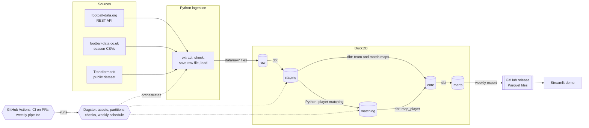

# Football Data Platform

[](https://football-data-platform-s7m7daktkrbs4pfapp9gqbz.streamlit.app)
[](https://github.com/fedepetr/football-data-platform/actions/workflows/ci.yml)

A data platform for Serie A and Premier League that integrates three public
sources, **reconciles teams, matches and players across them**, and produces
analytics: player profiles and similar players.

- **Sources**: football-data.org (API), football-data.co.uk (CSV), Transfermarkt (dataset)
- **Scope**: seasons 2024/25, 2025/26 and 2026/27 (in progress, refreshed weekly)
- **Stack**: Python 3.12 + uv, DuckDB, dbt, Dagster, GitHub Actions
- **Result**: 95.0% of football-data.org players matched to Transfermarkt; every
  played match linked across the three sources; 171 dbt tests and 109 Python tests
- **Demo**: [football-data-platform-s7m7daktkrbs4pfapp9gqbz.streamlit.app](https://football-data-platform-s7m7daktkrbs4pfapp9gqbz.streamlit.app), refreshed every week

## Demo

**[Open the demo](https://football-data-platform-s7m7daktkrbs4pfapp9gqbz.streamlit.app)**: a Streamlit app on the published data, refreshed
automatically every Tuesday by the pipeline.

- **Player**: profile, season statistics with the source of each number, market
  value history, and the player's id in each source with how it was matched.
- **Similar players**: the five closest players by statistics per 90 minutes,
  within the player's league or across both, with the numbers side by side.
- **Data quality**: reconciliation bands, score distribution, the hard cases
  decided by hand, and the cross-source checks that prove the matches are right.

Run it locally on your own database: `uv run --group demo streamlit run app/streamlit_app.py`.

## Architecture



- **Ingestion** (`src/fdp/ingest/`): each source is extracted, checked on arrival
  (structure, minimum rows, truncation), saved untouched to `data/raw/` and loaded
  into the `raw` schema with `_source_file`, `_loaded_at`, `_season`. Loads are
  idempotent.
- **Transformation** (`dbt/`): staging (types, names, JSON unnested), core
  (dimensions, maps, facts), marts (analytics).
- **Reconciliation** (`src/fdp/matching/`): teams and matches in dbt from a
  reviewed seed; players in a Python step between staging and core.
- **Orchestration**: Dagster assets for every raw table, dbt model and the player
  matching, seasons as partitions, dbt tests as asset checks.
- **Demo** (`app/`): a Streamlit app that reads only the published tables, through
  a declared data contract (tables and columns), never the pipeline code. Locally
  it reads `data/fdp.duckdb`; online, the Parquet files of the `demo-data` release.

## Quick start

Requirements: [uv](https://docs.astral.sh/uv/) and a free
[football-data.org token](https://www.football-data.org/client/register).

```bash
git clone https://github.com/fedepetr/football-data-platform.git
cd football-data-platform
cp .env.example .env          # then set FOOTBALL_DATA_ORG_TOKEN
uv sync
uv run dagster dev            # UI on http://127.0.0.1:3000
```

In the Dagster UI, materialize the assets (Lineage > Materialize all, choosing
all season partitions), or from the command line:

```bash
uv run dagster asset materialize -m fdp.definitions --select "group:fdorg or group:couk" --partition-range "2425...2627"
uv run dagster asset materialize -m fdp.definitions --select "group:transfermarkt"
uv run dagster asset materialize -m fdp.definitions --select "not (group:fdorg or group:couk or group:transfermarkt)"
```

A full load takes about 5 minutes (the football-data.org free plan allows 10
requests per minute). Then explore `data/fdp.duckdb` or run the checks:

```bash
uv run pytest
uv run --directory dbt dbt build
uv run --group demo streamlit run app/streamlit_app.py   # the demo on your data
```

Example queries for exploring the database: [docs/queries.sql](docs/queries.sql).

## Data sources

| Source | Content used | Access | Coverage and limits |
| --- | --- | --- | --- |
| [football-data.org](https://www.football-data.org) | fixtures, scores, referees, squads, scorers | REST API v4, free plan (10 requests/min) | every season in scope; no line-ups in the free plan |
| [football-data.co.uk](https://www.football-data.co.uk) | match statistics (shots, corners, fouls, cards), xG | season CSV files | played matches only; xG only from 2026/27 |
| [Transfermarkt](https://github.com/dcaribou/transfermarkt-datasets) (dcaribou/transfermarkt-datasets, CC0) | players, appearances, market values, transfers | public dataset files (Kaggle as alternative) | frozen on 2026-07-06: no 2026/27 |

Every source was sampled and checked before writing its ingestion; findings,
surprises (e.g. a default limit that silently truncated scorers) and decisions are
recorded in [docs/DEVELOPMENT.md](docs/DEVELOPMENT.md).

## Data model

```
raw ─► staging ─► core ─► marts
```

| Layer | Tables |
| --- | --- |
| Dimensions | `dim_competition`, `dim_season`, `dim_team` (49), `dim_player` (2309) |
| Maps | `map_team`, `map_match`, `map_player`: the reference of every entity in each source |
| Facts | `fct_match` (2280), `fct_team_match_stats` (3376), `fct_player_appearance` (46873), `fct_player_valuation` (36757), `fct_transfer` (16190), `fct_player_season_scoring` (1415) |
| Marts | `mart_player_profile` (player card per season), `mart_similar_players` (5 most similar per player and season) |

Every fact uses project keys (`team_key`, `match_key`, `player_key`, `season_key`),
so data from different sources lands on the same rows. No source covers every
season, so the player profile uses one source per season (Transfermarkt up to
2025/26, football-data.org for 2026/27) and says which.

## Reconciliation

**Teams** (49 teams, 3 sources). Names differ (`Inter` / `FC Internazionale
Milano` / `Inter Milan`), so a draft map is built by two independent methods and
then reviewed by hand into a dbt seed:

- names, compared on the letters of each word in order (longest common
  subsequence), with a tie-break and consistency checks (two names on the same
  team, non-mutual matches). Built step by step on the data: 45 -> 47 -> 48 -> 49
  correct out of 49;
- fixtures: the same match has the same date and score in two sources, so the
  teams of matching rows vote for each other.

136 of 147 references were sure; the 11 flagged ones were reviewed (one removed:
a promoted club that does not exist in the Transfermarkt dataset).

**Matches**: joined on date + home team + away team after team reconciliation.
Every played match is linked; zero date differences between sources.

**Players** (2220 football-data.org players to 50149 Transfermarkt players):

1. normalised names (no accents or punctuation, words sorted);
2. candidates with the same birth date, or the same team and season;
3. score 0-100: normalised Damerau-Levenshtein or `token_set_ratio`, the higher;
4. above 92 automatic, 80-92 review, below 80 rejected;
5. checks that send automatic matches to review (ties, collisions, a second
   opinion from the team method) and a reverse check on rejected matches with the
   same birth date and team;
6. manual corrections, re-read at every run.

| Band | Players | Share |
| --- | --- | --- |
| automatic | 2064 | 93.0% |
| manual (reviewed) | 44 | 2.0% |
| **matched** | **2108** | **95.0%** |
| rejected (mostly youth players missing from Transfermarkt) | 110 | 5.0% |
| reviewed, refused | 2 | 0.1% |

Score of the best candidate: 2051 players at 100, 17 between 92 and 100, 28 in
the review band, 124 below 80.

**Is it right?** Two independent checks, both dbt tests:

- the final score of every played match is identical in all three sources;
- for matched players, season goals agree between football-data.org and
  Transfermarkt in 98.9% of player-seasons (the rest differ by one goal), and
  season totals are equal. A wrong player match would break this.

A blocking Dagster asset check stops the pipeline if the match rate drops below 90%.

## Data quality

| Layer | Checks |
| --- | --- |
| Arrival (Python) | required structure, minimum rows, truncated responses |
| Staging and core (dbt) | `unique` + `not_null` keys, `relationships` from every fact to its dimensions, `accepted_values` on result and role |
| Reconciliation | every team and played match mapped; match rate >= 90% (blocking) |
| Cross-source | identical scores; goals per player within one goal |
| Completeness | completed seasons have teams x (teams - 1) matches, all finished |

## Automation

- `ci.yml`: lint, format, dbt parse and tests on every pull request.
- `weekly-pipeline.yml`: every Tuesday, a full rebuild on GitHub Actions (three
  sources, matching, dbt with its tests), then the demo app is tested against the
  new data (contract and every page) and the data is published to the `demo-data`
  release, which the online demo reads. The database is uploaded as an artifact.
- Dagster schedule `weekly_current_season`: refreshes only the current-season
  partition where the Dagster daemon runs.

## Known limitations

- Transfermarkt stops on 2026-07-06: no 2026/27 appearances, minutes or cards;
  2026/27 player profiles exist for scorers only (no line-ups in the free plan).
- xG only from 2026/27; no Serie A referees in football-data.co.uk (taken from
  football-data.org).
- Assists are counted differently by the sources (69% agreement): one source per season.
- 5.0% of football-data.org players are not matched (mostly youth players).
- Similar players use five output statistics per 90 minutes: similar output, not
  similar playing style.
- DuckDB has a single writer: runs are sequential.
- GitHub pauses scheduled workflows after 60 days without repository activity;
  the demo data then stops updating until the workflow is re-enabled.

## Repository layout

```
config/pipeline.yaml   seasons, competitions, source parameters, thresholds
src/fdp/ingest/        extraction and raw loading (one module per source)
src/fdp/matching/      team and player reconciliation
src/fdp/definitions.py Dagster wiring (assets, checks, job, schedule)
dbt/                   staging, core and marts models, seeds, tests
app/                   Streamlit demo, its data contract and Parquet export
tests/                 pytest
docs/DEVELOPMENT.md    development log: findings, decisions, review, metrics
```

## Credits

Data from [football-data.org](https://www.football-data.org),
[football-data.co.uk](https://www.football-data.co.uk) and
[transfermarkt-datasets](https://github.com/dcaribou/transfermarkt-datasets) by
David Cariboo (CC0, data from Transfermarkt).
